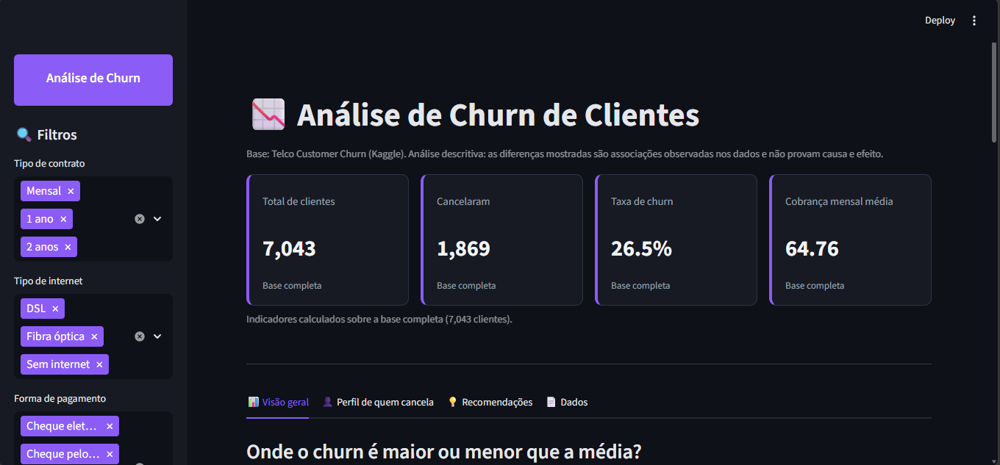
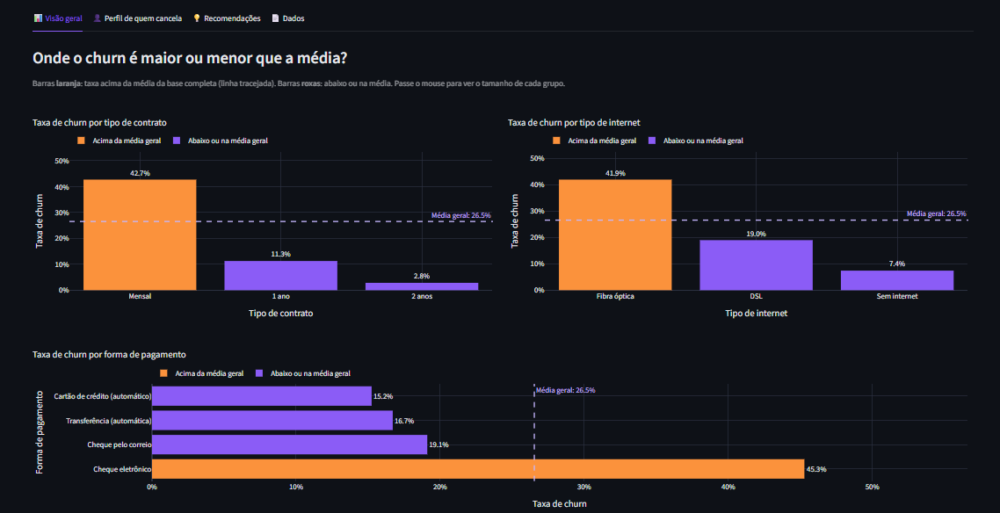
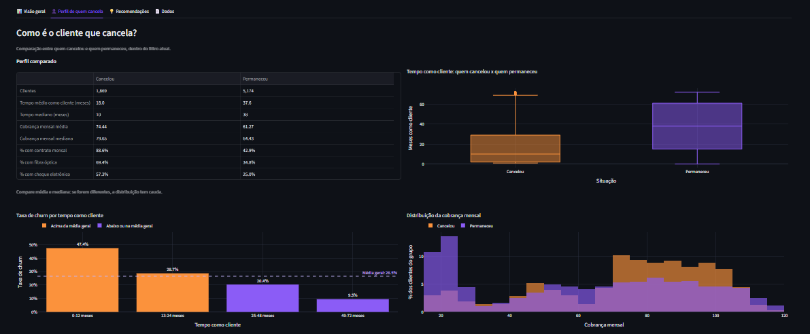
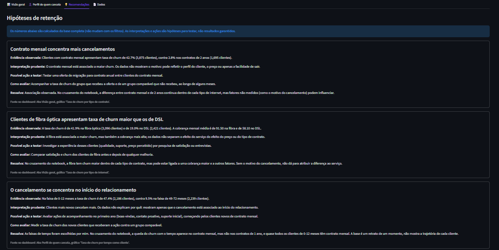

# 📉 Análise de Churn de Clientes — Python + Streamlit

Análise **descritiva** do cancelamento de clientes (*churn*) de uma operadora de telecomunicações, com um notebook de exploração e um dashboard interativo em Streamlit.

> **Pergunta central:** quem cancela, e quais características aparecem associadas ao cancelamento?
> **Aviso importante:** o projeto mostra **associações**. Nada aqui prova causa e efeito.

---

## ⚡ Visualização Rápida

- **Vídeo:** [assistir à demonstração](https://youtu.be/hXc_2r_CLHQ) | *Dica: para visualizar o dashboard com melhor qualidade, selecione 720p nas configurações do vídeo (⚙️ → Qualidade), caso o YouTube não ajuste automaticamente.*
- **Dashboard publicado:** _link será adicionado após a publicação._
- **Imagens do dashboard:** pasta [`screenshots/`](screenshots/) e galeria logo abaixo
- **Raciocínio da análise, passo a passo:** [`eda.ipynb`](eda.ipynb) (já salvo com as saídas, dá para ler direto no GitHub)


| Título e Cartões |
|---|
|  |

| Visão geral | Perfil de quem cancela |
|---|---|
|  |  |

| Recomendações (hipóteses) |
|---|
| |

---

## 🎯 Objetivo e perguntas investigadas

**Objetivo:** investigar quem cancela (churn), quais características aparecem associadas ao cancelamento e como esses padrões podem apoiar decisões de retenção. A versão atual é **descritiva**: ela organiza e mostra os dados, e não prova causa e efeito.

| Pergunta | Onde é respondida |
|---|---|
| Qual é a proporção de clientes que cancelaram? | Cartões do dashboard e `eda.ipynb` (seção 4.1) |
| A taxa de churn varia conforme o tipo de contrato? | Aba Visão geral |
| Há diferenças por tipo de internet ou forma de pagamento? | Aba Visão geral |
| O tempo como cliente (`tenure`) é diferente entre quem cancelou e quem permaneceu? | Aba Perfil de quem cancela |
| Como as cobranças mensais se distribuem entre os grupos? | Aba Perfil de quem cancela |
| Quais segmentos merecem investigação mais aprofundada? | Aba Recomendações e `eda.ipynb` (Etapa 6) |

---

## 🔎 Principais achados

Base analisada: **7.043 clientes**, com taxa de churn geral de aproximadamente **26,5%**.
Cada achado aponta para o gráfico do dashboard onde ele aparece.

| # | Achado (associação observada) | Evidência | Onde ver no dashboard |
|---|---|---|---|
| 1 | Contrato mensal concentra mais cancelamentos | Mensal 42,7% contra 2 anos 2,8% | Visão geral › *Taxa de churn por tipo de contrato* |
| 2 | Fibra óptica tem churn maior que DSL | Fibra 41,9% contra DSL 19,0% | Visão geral › *Taxa de churn por tipo de internet* |
| 3 | O cancelamento se concentra no início do relacionamento | 0-12 meses cerca de 47%, 49-72 meses cerca de 9,5% | Perfil de quem cancela › *Taxa de churn por tempo como cliente* |
| 4 | Cheque eletrônico aparece associado a mais churn | Cheque eletrônico 45,3% contra 15% a 19% nas demais formas | Visão geral › *Taxa de churn por forma de pagamento* |

**Verificação de sobreposição.** Contrato, internet, forma de pagamento e tempo como cliente estão ligados entre si. Por isso o notebook cruza os fatores (taxa de churn de um fator *dentro* de cada tipo de contrato; células com menos de 100 clientes são ignoradas). O que esse cruzamento mostrou:

- **Contrato:** a diferença entre mensal e 2 anos continua dentro de cada tipo de internet.
- **Fibra:** o churn é maior que no DSL em todos os tipos de contrato. A fibra também tem mais contratos mensais (cerca de 69% contra 51% no DSL).
- **Tempo como cliente:** a queda do churn com o tempo aparece no contrato mensal (51,4% → 26,0%), mas não no contrato de 1 ano. Cerca de 91% dos clientes de 0-12 meses têm contrato mensal.
- **Cheque eletrônico:** o churn continua maior dentro do contrato mensal (53,7% contra 31,6% a 34,1%), mas a diferença é menor do que na base toda, porque 78% desses clientes estão no contrato mensal.

Cada achado vem com **interpretação prudente, ação a testar, como avaliar, fonte e ressalva**. Eles estão no notebook (seção *Etapa 6: Insights*) e na aba **Recomendações** do dashboard.

---

## ▶️ Como executar
Não é necessário executar o projeto para conhecer seus resultados. A demonstração em vídeo, as capturas de tela e o notebook permitem explorar a interface e acompanhar o raciocínio da análise sem instalar as dependências.

> **O arquivo de dados (CSV) não está neste repositório.** A licença da base no Kaggle é "Data files © Original Authors" e não autoriza explicitamente a redistribuição. Para reproduzir a análise, baixe a base [Telco Customer Churn no Kaggle](https://www.kaggle.com/datasets/blastchar/telco-customer-churn) e siga as instruções abaixo. Para conhecer os resultados sem executar o projeto, consulte o vídeo de demonstração, as capturas de tela e o notebook disponíveis neste README.

**Pré-requisitos:** Python 3.11 ou superior, `git` e uma conta gratuita no Kaggle (só para baixar o CSV).

### Passo 1: baixar o projeto e instalar as dependências

```bash
git clone https://github.com/AugustoSnts/analise-churn-telecom.git
cd analise-churn-telecom

python -m venv .venv
source .venv/bin/activate          # Windows (PowerShell): .venv\Scripts\Activate.ps1
pip install -r requirements.txt
```

### Passo 2: baixar o CSV

1. Abra https://www.kaggle.com/datasets/blastchar/telco-customer-churn e clique em **Download**.
2. Extraia o arquivo `WA_Fn-UseC_-Telco-Customer-Churn.csv` (o Kaggle entrega um `.zip`).
3. Copie para a pasta `data/` **sem renomear**.

O caminho final deve ser `data/WA_Fn-UseC_-Telco-Customer-Churn.csv`.

### Passo 3: abrir o dashboard

```bash
streamlit run app.py
```

Rode sempre a partir da **pasta raiz** do projeto (a mesma que contém `app.py`). O navegador abre em `http://localhost:8501`.

### (Opcional) Passo 4: abrir o notebook

O notebook usa o Jupyter, que fica em um arquivo de dependências à parte (o dashboard não precisa dele):

```bash
pip install -r requirements-notebook.txt
jupyter notebook eda.ipynb
```

Abra o Jupyter a partir da **pasta raiz** do projeto (é de onde o notebook procura `data/`) e execute as células de cima para baixo (*Run All*).

### Sem copiar o arquivo para `data/`

Se o app não encontrar o CSV, ele mostra na tela o link do Kaggle e os 3 passos (baixar, extrair e enviar) e abre um campo para você enviar o arquivo. Envie o `.csv` que está dentro do `.zip`: o app valida as colunas e funciona igual. O arquivo vale só para a sua sessão e não é salvo no repositório.

### Se algo não funcionar

| Mensagem ou sintoma | Causa provável | O que fazer |
|---|---|---|
| O app abre mostrando os 3 passos para enviar o CSV | O CSV não está em `data/` com o nome certo (é o comportamento esperado no app publicado) | Siga os 3 passos da tela, ou salve o arquivo como `data/WA_Fn-UseC_-Telco-Customer-Churn.csv` (nome original, sem renomear) |
| `ModuleNotFoundError` | Dependências não instaladas ou ambiente virtual desativado | Ative o `.venv` e rode `pip install -r requirements.txt` |
`ModuleNotFoundError` ao abrir o notebook (por exemplo, `jupyter`) | Dependências do notebook não instaladas | Rode `pip install -r requirements-notebook.txt` |
| `streamlit: command not found` | Streamlit instalado fora do ambiente ativo | Use `python -m streamlit run app.py` |
| Erro dizendo que faltam colunas | O arquivo enviado não é o da base Telco | Baixe novamente do link do Kaggle |

---

## 🧭 Como o projeto funciona

### Estrutura do repositório

```
analise-churn-telecom/
├── app.py                 # dashboard Streamlit (só a interface)
├── eda.ipynb              # notebook: inspeção, limpeza, exploração e insights
├── requirements.txt       # dependências do dashboard, com versões fixadas
├── requirements-notebook.txt  # dependências extras para abrir o notebook
├── .streamlit/
│   └── config.toml        # tema escuro com roxo como cor de destaque
├── src/
│   ├── dados.py           # carga e limpeza dos dados
│   ├── analise.py         # filtros, indicadores, comparações e insights
│   └── graficos.py        # gráficos Plotly e paleta de cores
├── data/
│   └── README.md          # como obter o CSV (o arquivo em si não é versionado)
└── screenshots/           # imagens do dashboard usadas neste README
```

### Fluxo dos dados

```
CSV (Kaggle) → src/dados.py → src/analise.py → src/graficos.py → app.py
               carga+limpeza   números e textos  gráficos Plotly   tela
```

| Arquivo | Responsabilidade | Depende do Streamlit? |
|---|---|---|
| `src/dados.py` | Ler o CSV, validar colunas, limpar e criar colunas derivadas | Não |
| `src/analise.py` | Filtros, indicadores, taxa de churn por grupo, ranking de segmentos e insights | Não |
| `src/graficos.py` | Gráficos Plotly e paleta de cores | Não |
| `app.py` | Apenas a interface: filtros, cartões, abas, textos | Sim |
| `eda.ipynb` | Raciocínio da análise: inspeção, limpeza, exploração e insights | Não |

Essa divisão deixa o cálculo separado da tela: o mesmo código de `src/` é usado pelo notebook e pelo dashboard, então os números são os mesmos nos dois.

### Preparação dos dados

Todas as decisões estão registradas no notebook (seção *Registro de decisões*). As principais:

| Decisão | Motivo |
|---|---|
| O CSV original nunca é alterado; toda limpeza é feita em memória, em uma cópia | Reprodutibilidade |
| `TotalCharges` vem como texto e tem 11 células em branco; é convertida para número | Permite cálculos |
| Os 11 casos em branco são clientes com `tenure = 0` (ainda não cobrados); recebem `0`, e só depois de conferir que **todos** têm `tenure = 0` | Evita preencher valores às cegas |
| `Churn` (Yes/No) vira a coluna numérica `Churn_Flag` (1/0) por mapeamento explícito | Permite calcular a taxa como média |
| Existem verificações de IDs duplicados, valores inesperados e colunas obrigatórias, com mensagens de erro legíveis | O app não quebra em silêncio |
| Rótulos traduzidos para o português (ex.: *Month-to-month* → *Mensal*) | Leitura no dashboard |
| A variável `tenure` foi agrupada em faixas de 0–12, 13–24, 25–48 e 49–72 meses. Os intervalos foram definidos para esta análise e podem influenciar a interpretação dos resultados. | Os limites foram escolhidos por mim e a leitura pode mudar com outros |

### Indicadores do dashboard

| Indicador | Definição |
|---|---|
| **Total de clientes** | Número de clientes no conjunto filtrado |
| **Clientes que cancelaram** | Clientes com `Churn = Yes` no conjunto filtrado |
| **Taxa de churn** | Cancelaram ÷ total de clientes do conjunto filtrado |
| **Cobrança mensal média** | Média de `MonthlyCharges` do conjunto filtrado |

Cada cartão compara o resultado do filtro atual com a base completa. A diferença é apresentada na unidade adequada a cada indicador; para a taxa de churn, a comparação é expressa em pontos percentuais.

**Filtros (barra lateral):** tipo de contrato, tipo de internet, forma de pagamento, situação do cliente e tempo como cliente (meses). Eles se combinam com **E**.

**Abas:**
- **📊 Visão geral:** taxa de churn por contrato, internet e forma de pagamento.
- **👤 Perfil de quem cancela:** comparação entre quem cancelou e quem permaneceu, e taxa por tempo como cliente.
- **💡 Recomendações:** os 4 insights em formato de hipóteses. Usa sempre a base completa, não muda com os filtros.
- **📄 Dados:** tabela do filtro atual e botão para baixar o CSV filtrado.

**Cores:** o dashboard utiliza tema escuro, com roxo e laranja para diferenciar categorias e destacar taxas em relação à média. Setas e rótulos complementam as cores, permitindo interpretar os indicadores sem depender exclusivamente da distinção visual entre elas.

---

## ⚠️ Limitações

- **Análise descritiva:** mostra associações e não mede o efeito de nenhuma ação. Para avaliar uma ação de retenção seria preciso acompanhar os indicadores ao longo do tempo e comparar grupos semelhantes, com e sem a ação.
- A base é um retrato de um momento. Não mostra a trajetória de cada cliente nem o **motivo** do cancelamento.
- É uma base pública, que pode não representar uma operação real.
- As faixas de tempo foram definidas por mim; outros limites podem mudar a leitura.
- Não há modelo preditivo: o objetivo é entender o padrão, não prever quem vai cancelar.

## 📜 Dados e licença

- **Fonte:** *Telco Customer Churn* (Kaggle): https://www.kaggle.com/datasets/blastchar/telco-customer-churn
- O CSV **não** é redistribuído aqui porque a licença da base indica "Data files © Original Authors". Veja [`data/README.md`](data/README.md).
- O código deste repositório é de autoria própria.

## 🔭 Próximos passos

- Medir, em um cenário real, o efeito das ações propostas (teste A/B).
- Incluir uma análise multivariada para separar o efeito de cada fator.
- Explorar um modelo preditivo de churn, com validação adequada.

## 👤 Autor

**Caio Augusto L. Santos** · [LinkedIn](https://www.linkedin.com/in/augusto-santos-page/) · [GitHub](https://github.com/AugustoSnts)
